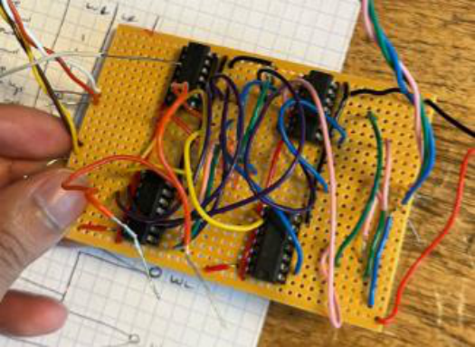
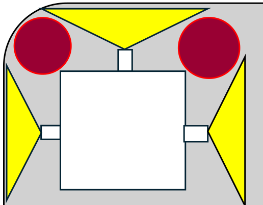
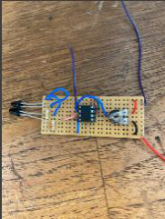
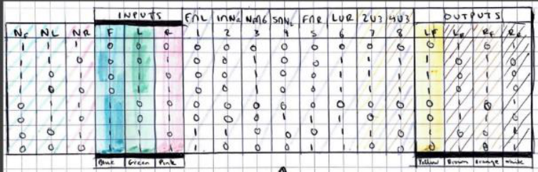
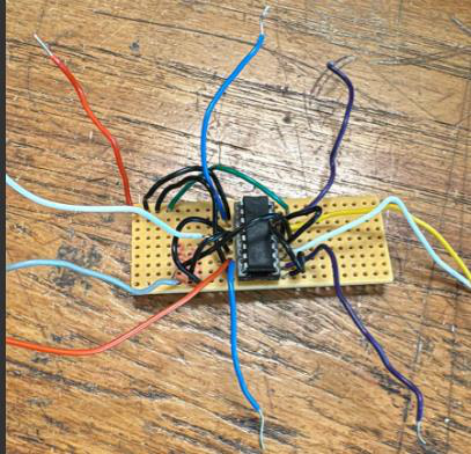

# Autonomous Maze Robot Car

A first-year Electrical and Electronic Engineering group project exploring obstacle detection, hardware logic and motor control for an autonomous robot car.

**Design objective:** build a car that could navigate a maze using circuitry rather than programmed navigation software.

## Project overview

The design used three infrared sensors to detect nearby walls. Their binary outputs were inputs to a logic circuit that selected movement commands for the motor-drive stage.

This portfolio documents the project from its surviving poster. It includes the original circuit photographs, sensor-coverage diagram and photographed truth table. The poster establishes the design objective and development work, but does not provide a verified end-to-end maze completion result.

## System architecture

| Stage | Function |
| --- | --- |
| Infrared sensing | Detect nearby walls using IR LEDs and photodiodes |
| Sensor circuitry | Produce a wall-detection signal for the logic stage |
| Hardware logic | Select movement commands from combinations of sensor inputs |
| Motor-drive circuit | Drive the car's two motors according to the logic outputs |

The poster defines **wall detected = 1** and **wall not detected = 0**. It labels the movement commands as forward, left and right, together with their negated signals.

## Sensor arrangement

Three sensors were arranged to cover most of the front of the car. The poster identifies small blind spots at its front corners.

- **Reported obstacle-detection distance:** approximately **4.7–5.1 cm**.
- **IR photodiode:** SFH 203 FA; the poster lists a ±20° cone.
- **IR LED:** SFH 4545; the poster lists a ±30° cone.

These distances and angles are reproduced from the poster, not independently measured here. It does not specify a repeatable test method or quantify performance under different lighting or wall surfaces.

## Hardware recorded in the poster

| Component | Documented role or detail |
| --- | --- |
| SFH 203 FA IR photodiode | Infrared sensing |
| SFH 4545 IR LED | Infrared illumination |
| LM358N | IC used in the sensor/circuit design; exact topology not established by the poster |
| H-bridge motor-drive stage | Control two motors; exact IC marking needs verification |
| 6 V supply | Supply voltage stated for the motor-drive design |
| Circuit boards and wiring | Sensor, logic and motor-driver prototypes pictured in the poster |

**Motor-driver identification:** the poster labels the H-bridge as “LM293”. Texas Instruments identifies LM293 as a dual comparator, while L293/L293D are motor-driver devices. The poster may contain a naming error, but the actual fitted part cannot be confirmed from the supplied material. This repository therefore does not assume a particular driver variant or claim built-in motor transient protection.

Manufacturer references: [LM293](https://www.ti.com/product/LM293), [L293/L293D datasheet](https://www.ti.com/lit/ds/symlink/l293.pdf).

## Logic design

The poster includes a photographed truth table connecting the sensor inputs to movement-control signals. It is preserved below as evidence of the original design work.

The source image is too small to confidently reconstruct every entry or derive verified Boolean equations. No guessed truth table, gate schematic or navigation priority has been added.

## Motor-drive prototype

The poster describes a dual-bridge arrangement intended to control two motors from the logic outputs, using a 6 V supply. Exact wiring, motor specifications and the fitted driver part number are not recoverable with confidence from the poster alone.

## Development challenges

The group recorded several problems during development:

- The initial H-bridge design did not work after soldering. Overlapping solder was suggested as a possible cause, rather than a confirmed diagnosis.
- Complex wiring made it difficult for group members to understand one another's circuits.
- Interruptions between lab sessions made it harder to resume work efficiently.
- Limited experience of group engineering projects affected coordination.
- Broken ICs caused additional difficulties.

These observations highlight practical issues in circuit assembly, troubleshooting, wiring organisation and team handover. The poster does not record confirmed fixes for each issue.

## Team and contribution

**Team:** Shane Whittaker, Eli Dick, Shawn Wang and Surjo Datta.

This repository is presented by **Surjo Datta** as a record of a first-year group project. The poster lists team membership but does not allocate individual tasks, so circuit design, construction and testing are credited to the group rather than attributed to one member.

## Available documentation

- [Project poster](docs/project-poster.pdf) — public copy with student IDs removed.
- [Documentation notes](docs/documentation-notes.md) — evidence limits and the motor-driver naming discrepancy.
- `images/` — original circuit photographs and truth table, plus the sensor diagram extracted from the poster.

Only the poster was supplied. There are no recovered editable schematics, complete bill of materials, software files or detailed test logs. This is a documentation portfolio, not a complete construction package.

## Possible next steps

These are proposed improvements, not completed project features:

- Verify the fitted motor-driver IC and its supply and protection requirements.
- Recover circuit schematics and transcribe the truth table from a clearer original.
- Improve wiring labels and check solder joints before integrated testing.
- Characterise detection distance under different lighting and wall reflectivity.
- Review sensor placement to reduce front-corner blind spots.
- Record repeatable navigation tests and individual contributions.
